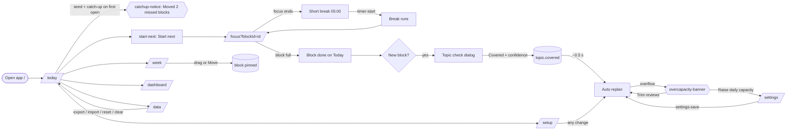

# FocusPlan User Flows

> Every step names the screen, the visible label and the `data-testid`, so QA can script it directly. The screens are specified in `screens/`.

## Overview

---

## Flow 1: First open (demo) and catch-up (F7, F9)
1. The user opens `/`. `bootstrap.ts` runs `seedIfEmpty()` before the first render, and the router redirects to `/today`.
2. `PlanSync` mounts and runs `catchUpOnOpen()`. The two past-due blocks (Derivatives and Alkanes from yesterday) are removed and rescheduled for today or later.
3. The Plan status bar shows `Updating plan…` (`plan-status`), then `Plan up to date · rebuilt just now`.
4. `catchup-notice` appears with the text `Moved 2 missed blocks` and the sub line `They're now on today or later, still before their exams.`
5. Today lists the queue (`today-block` × n), including `Problem set 3` with a `Task` badge. The **Up next** card shows the first planned block with `start-next`.
6. The user dismisses the notice (`catchup-dismiss`). It stays hidden for the rest of the session.

**Empty and error branches**
- 2a. Nothing is past due, so `movedCount` is 0 and there is no notice.
- 2b. Catch-up cannot fit the work, so `overcapacity-banner` appears as well (Flow 7).
- 1a. IndexedDB is unavailable. Every page shows `page-error` "We couldn't read your study data", and `Reload` retries.

## Flow 2: Start the next block and finish a pomodoro (F4, F5, F6)
1. On `/today`, the user clicks **Start next** (`start-next`). The app navigates to `/focus?blockId=<first planned-or-partial block id>`.
2. The Focus page shows `timer-phase` `Focus`, `timer-display` `25:00`, and `timer-active-block` with the topic, subject and `0/2`.
3. The user clicks **Start** (`timer-start`). The first time, the browser asks for notification permission. The countdown runs and the tab title reads `24:59 · Focus — FocusPlan`.
4. Optionally, the user clicks **Pause** (`timer-pause`); the display freezes and the button becomes **Resume** (`timer-resume`).
5. At 00:00 a chime plays, and a notification titled `Focus complete` with the body `Nice work. Take a 5-minute break.` is shown (when permitted and enabled). A session is stored, the block becomes `1/2`, and the phase becomes `Short break` at `05:00`, idle, with the button reading **Start break**.
6. The user starts the break. At its end the notification reads `Break over` / `Ready for the next pomodoro?`, and the phase returns to `Focus` at `25:00`, idle.
7. After the second focus the block reaches `2/2` and its status becomes `done`. The active-block card shows `Block complete` and the link **Next: Chain Rule →** (`timer-next-block`).
8. Every 4th completed focus leads to `Long break` at `15:00` (the value comes from settings).

**Branches**
- 3a. Permission is denied or unsupported, or notifications are off in Settings. `notifications-hint` shows `Notifications are off. You'll still hear the chime and see the time in the tab title.` The timer continues normally.
- 3b. The user navigates away while the timer runs. The nav shows the `nav-timer` pill `24:12 · Focus`, and clicking it returns to `/focus`.
- 3c. The tab is backgrounded or reloaded. The remaining time is recomputed from `endsAt`, and after a reload the timer is still running.
- Skip (`timer-skip`) moves to the next phase without crediting a pomodoro. Reset (`timer-reset`) returns to an idle `Focus` at the configured length, and the title becomes `FocusPlan`.
- 1a. There is no planned block today, so `start-next` is not rendered. The Today empty state shows instead (Flow 3).
- 2a. The `blockId` no longer exists (it was replanned or deleted). A warning line reads `That block is no longer in your plan. This session will count as free focus.`

## Flow 3: Mark progress on Today (F6)
1. The user clicks **Done** (`block-done`) on a `New` block. The block shows done styling, `2/2 pomodoros` and a `Done` badge.
2. The **Topic check** dialog opens (`topic-check-dialog`): "Topic check: Derivatives".
3. The user picks a confidence (`confidence-1` Shaky, `confidence-2` Okay, `confidence-3` Solid), then clicks **Covered** (`topic-check-covered`). The topic becomes `covered: true, confidence: n`, and a `Covered` badge appears on every block of that topic and in Setup.
4. About 0.5 s later the plan rebuilds. With confidence 1, one extra `Review` block appears.
5. Alternatively the user clicks **Not yet** (`topic-check-not-yet`, or presses Esc). The topic stays uncovered.

**Partial:** **Partial** (`block-partial`) opens the dialog "How many pomodoros did you finish?" with options `partial-option-1`…`m−1`. **Save** (`partial-save`) gives the status `partial`, the progress `1/2 pomodoros` and a `Partial` badge. For 1-pomodoro blocks, Partial is disabled with the tooltip `Single-pomodoro blocks can only be Done or Skipped.`

**Skip:** **Skip** (`block-skip`) gives dashed skipped styling and a `Skipped` badge, and the block is no longer the `start-next` target.

**All done:** when every block today is done or skipped, the Up next card is replaced by `today-empty` **"All done for today"**, and the finished blocks stay listed below.

**Undo:** `block-undo` on a done or skipped block sets its status back to `planned` (or `partial` if `0 < completed < pomodoros`).

## Flow 4: Set up a new subject, exam and topics (F1)
1. On `/setup`, the user types `Biology` in **Subject name** (`subject-name-input`), picks a colour (`subject-color-rose`) and clicks **Add subject** (`subject-add`). A `subject-item` appears with its swatch (`subject-swatch`).
2. In that subject, the user clicks **Add exam** (`exam-add-open`), fills **Exam name** `Cell Biology Final` (`exam-name-input`) and **Date** (`exam-date-input`, today+12), then clicks **Add exam** (`exam-add`). The `exam-item` shows `exam-countdown` `in 12 days`.
3. The user clicks **Quick add** (`quick-add-toggle`) and pastes `Cells⏎Genetics⏎⏎Evolution` into `quick-add-input`. The button label updates to **Add 3 topics** (`quick-add-submit`). On click, 3 `topic-item`s appear, each with estimate `2` and difficulty `Medium`.
4. The Plan status bar shows `Updating plan…`, and the new blocks appear on Today and Week about 0.5 s later.

**Errors:** an empty name shows `Give the subject a name.`, `Give the exam a name.` or `Give the topic a name.`, and nothing is saved. A past exam date shows `The exam date can't be in the past.` An estimate outside 1–20 shows `Estimate must be 1–20 pomodoros.` Quick add with only blank lines shows `Paste at least one topic name.`

**Deletes:** **Delete exam** (`exam-delete`) opens `confirm-dialog` "Delete Cell Biology Final?" with the body `This also deletes its 3 topics and 6 blocks. Focus history stays in your stats.` **Delete exam** (`confirm-ok`) removes them all, and **Cancel** (`confirm-cancel`) removes nothing.

**Empty:** with no subjects, `setup-empty` shows "Start with a subject" and the add form stays visible.

## Flow 5: Adjust availability (F2)
1. On `/settings`, the capacities are prefilled as Mon–Fri 6, Sat 8, Sun 4 (`capacity-1`…`capacity-6`, `capacity-0`).
2. The user sets Wed (`capacity-3`) to `3`. The sticky footer shows `You have unsaved changes`.
3. The user clicks **Save settings** (`settings-save`). The toast reads `Settings saved`, and the plan rebuilds about 0.5 s later.
4. The user adds a blackout date: they pick a date in `blackout-date-input`, click **Add date** (`blackout-add`), and a `blackout-item` appears marked `Not saved yet`. After **Save settings** nothing is scheduled on that date.

**Errors:** an out-of-range value shows an inline error (for example `Focus must be 5–120 minutes.`) and the footer reads `Fix 1 field to save.` The **Save settings** click then focuses the first invalid field and saves nothing. A past blackout date shows `Blackout dates can't be in the past.` A duplicate shows `That date is already blacked out.`

**Leaving with unsaved changes:** in-app navigation discards the edits. React Router's `useBlocker` needs a data router, and this app uses `BrowserRouter`, so there is no in-app guard; the sticky footer makes the unsaved state obvious. Reloading or closing the tab while dirty triggers the browser's native `beforeunload` prompt.

## Flow 6: Rearrange the week (F4)
1. On `/week`, the user sees 7 `week-day-YYYY-MM-DD` columns from Mon to Sun, with today highlighted (`data-today="true"`).
2. They drag a `block-card` to another column. The column highlights with `Drop to move here`. On drop the block's date changes, `pinned=true`, and the toast reads `Moved to Tue 22 Sep`.
3. Keyboard or touch alternative: the user focuses the card, presses Enter to open the block menu, chooses **Move** (`block-move`), picks a date (`block-move-date`) and clicks **Move block** (`block-move-save`).
4. **Next week** (`week-next`) and **Previous week** (`week-prev`) change `?start=` and the columns. **This week** (`week-today`) returns to the current week.
5. **Add task** (`add-task-open`) opens a dialog: `Read chapter 4`, tomorrow, 2 pomodoros, Physics, then **Add task** (`add-task-submit`). A card with a `Task` badge appears in tomorrow's column and survives **Replan**.

**Errors:** dropping on a past day or on or after the block's exam is refused. The column shows a `not-allowed` cursor, and on drop the toast reads `Can't move a block to a past day.` or `That's on or after the exam (Wed 29 Sep). Pick an earlier day.`

**Empty:** a week with no blocks shows `week-empty` "Nothing planned this week".

## Flow 7: The plan doesn't fit (F7)
1. The user sets every capacity to `1` in Settings and clicks **Save settings**.
2. About 0.5 s later `overcapacity-banner` appears: "**14** pomodoros don't fit before your exams", with one `overcapacity-item` per exam.
3. The user clicks **Trim reviews** (`trim-reviews`). The largest review offset is dropped and the plan rebuilds. The toast reads `Removed the +7 day review. Plan rebuilt.`, and `overcapacity-total` goes down.
4. **Raise daily capacity** (`overcapacity-settings-link`) opens `/settings`. When the user restores the capacities and saves, the banner disappears.

## Flow 8: Check readiness (F8)
1. On `/dashboard`, the stat tiles show `focus-today` (minutes), `focus-week` and `streak-count` (`5` on the seed).
2. The `exam-card`s are sorted by date: Organic Chemistry Quiz `in 7 days`, Calculus Midterm `in 10 days`, Mechanics Test `in 14 days`. Each has `readiness` `NN%` and `topics-covered` such as `1/5 topics covered`.
3. `focus-chart` shows the last 7 days as bars stacked by subject, with a legend.
4. **Empty:** with no exams, `dashboard-empty` shows "No upcoming exams" with **Go to Setup**.

## Flow 9: Back up, restore and reset (F9)
1. On `/data`, **Export backup** (`export-button`) downloads `focusplan-backup-2026-09-19.json`. The toast reads `Backup downloaded`.
2. **Choose backup file** (`import-input`) → validation → `confirm-dialog` "Replace all your data?" → **Replace my data**. The toast reads `Backup imported: 3 subjects, 3 exams, 12 topics.`
3. A malformed file shows `import-error`: `That file isn't valid JSON. Nothing was changed.` (or a more specific reason). No dialog appears.
4. **Reset to demo** (`reset-demo`) → confirm → the toast reads `Demo semester loaded`.
5. **Clear all data** (`clear-all`) → confirm with **Clear everything** → the toast reads `All data cleared`. Today then shows `today-empty` "Nothing planned yet" with **Go to Setup**.
