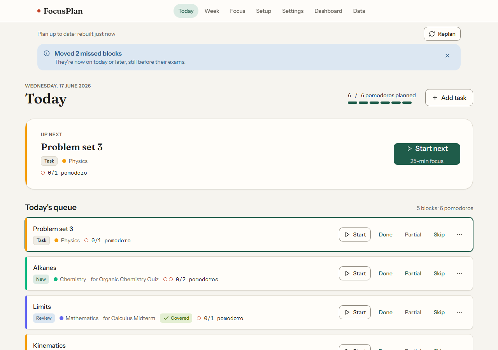
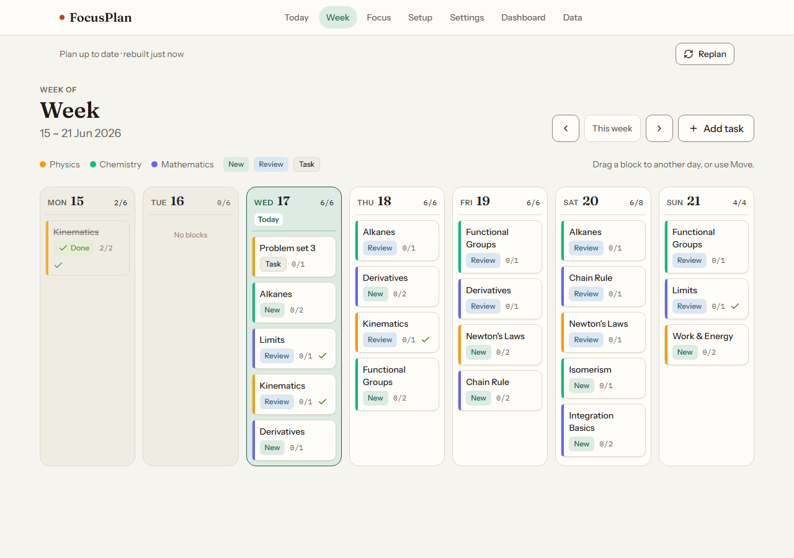
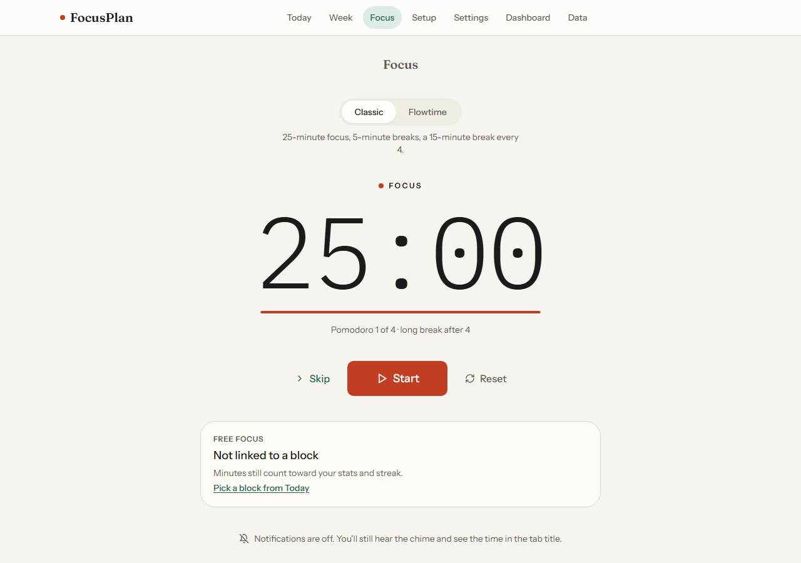
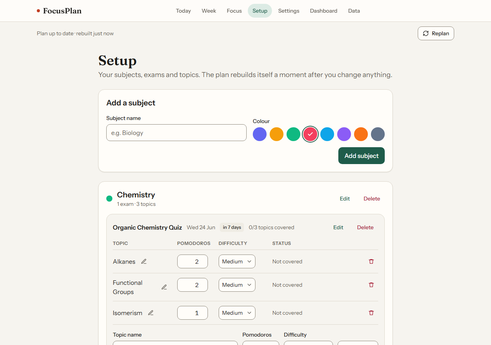
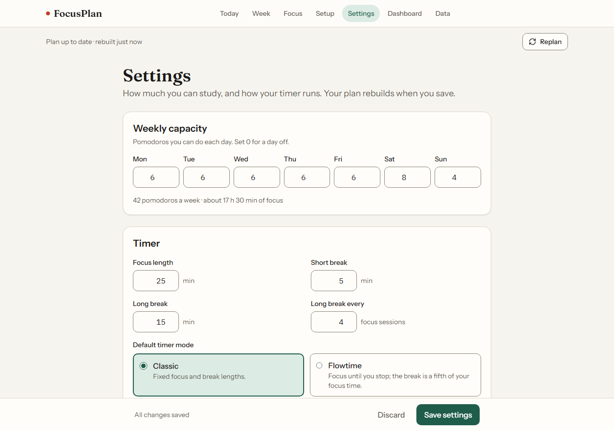
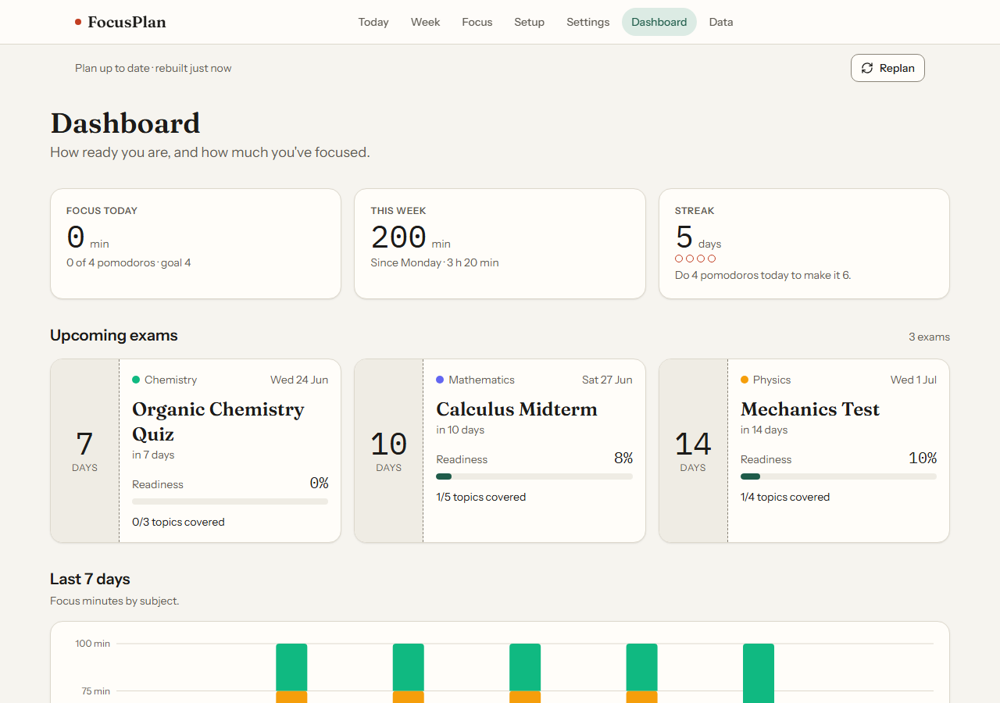
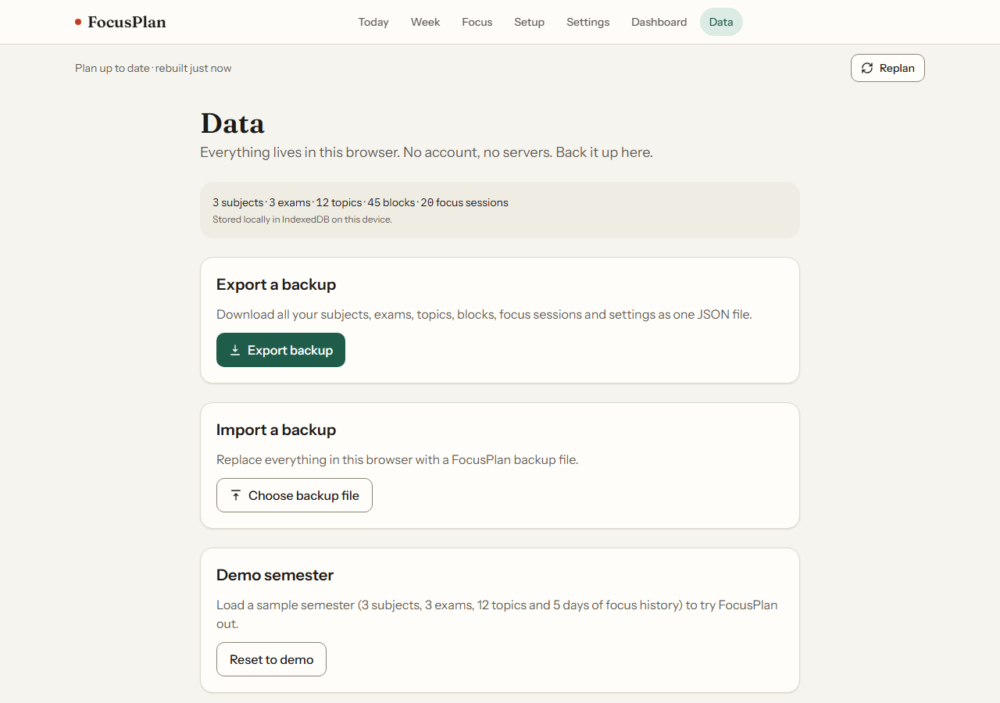

# FocusPlan

**A local-first study planner that works backward from your exam dates and drops every planned session straight into a Pomodoro timer.**

FocusPlan turns "exam on date X covering topics A–F" into a day-by-day, Pomodoro-sized study plan, with a timer built in, so you never have to translate between a planner and a separate timer app. No account, no server, no ads: everything lives in your browser.

## The problem

Students juggle two disconnected tools: planners that record deadlines but don't say what to study today, and focus timers that time the work but don't help break it down. Neither one recovers gracefully when a day gets missed. Research on student procrastination found that 87% of students self-identify as procrastinators and 40% say they don't know where to start — a planning problem — while 48% cite distraction — a focus problem (see `.pipeline/research-report.md` for sources). FocusPlan treats the plan and the timer as one thing.

## Key features

- **Exam-backward spaced planner** (USP): enter a subject, an exam date and topics with a Pomodoro effort estimate, and FocusPlan auto-generates a day-by-day plan of study blocks, with spaced review sessions, that respects your daily capacity and never schedules new work after the exam.
- **Plan-to-timer in one click** (USP): every planned block has a Start action that opens the Pomodoro timer already linked to that topic, and completed Pomodoros are credited back to it automatically.
- **Automatic catch-up rescheduling** (USP): missed blocks are moved into your remaining capacity the next time you open the app, with an over-capacity banner (and a one-click "Trim reviews" fix) if the plan no longer fits before an exam.
- **Exam readiness dashboard** (USP): a readiness percentage, days-left countdown and topic coverage per exam, plus a 7-day focus-minutes chart by subject and a daily-goal streak.
- **Local-first, no account** (USP): all data lives in IndexedDB in your browser. JSON export/import gives you a portable backup, and "Reset demo data" / "Clear all" let you start over.
- Configurable Pomodoro timer: classic (focus/short break/long break with a configurable cadence) or a flexible Flowtime mode, timestamp-based so it stays accurate in a throttled background tab and survives a page reload.
- Today and Week views with drag-and-drop rescheduling, manual ad-hoc tasks, and Done / Partial / Skip completion tracking with an Undo.

## Screenshots

Captured during QA (`.pipeline/qa-screenshots/`), at 1280×900 and 375×812:

| Today | Week | Focus |
|---|---|---|
|  |  |  |

| Setup | Settings | Dashboard | Data |
|---|---|---|---|
|  |  |  |  |

## Tech stack

| Layer | Choice |
|---|---|
| Frontend | Vite 8 + React 19 + TypeScript, React Router 7 (`BrowserRouter`), Tailwind CSS 4 (`@tailwindcss/vite`) |
| Backend / API | None. The app is a fully client-side SPA; there is no server and no HTTP API. Internal module contracts stand in for it (see `docs/api-reference.md`) |
| Data | IndexedDB via Dexie 4, read reactively with `dexie-react-hooks` (`useLiveQuery`). The running timer is mirrored to `localStorage` |
| Utilities | `date-fns`, `recharts` (dashboard chart), `clsx` |
| Auth | None (no accounts, by design) |
| Testing | Playwright (Chromium, e2e) + Vitest (unit tests, node environment) + `fake-indexeddb` |
| Lint | `oxlint` |

## Quick start

All commands run from the `app/` directory.

```bash
cd app
npm install && npx playwright install chromium   # install deps + the Chromium browser for e2e

npm run dev            # start the dev server -> http://localhost:5173

npm run build          # tsc -b && vite build (production build, exits 0 with no TS errors)
npm run preview        # serve the production build locally on http://localhost:4173

npm run test:unit      # vitest run — unit tests for the scheduler, timer and stats
npx playwright test    # e2e tests (starts the dev server automatically); alias: npm run test:e2e

npm run lint           # oxlint
```

No environment variables and no `.env` file are needed: FocusPlan makes no network requests beyond serving its own static assets (confirmed in QA — see `docs/testing.md`).

Requires Node **20.19+ or 22.12+** (Vite 8 requirement).

## Project structure

```
study-planner-pomodoro/
  .pipeline/            research, plan, design, QA and phase-handoff records for this build
  app/                  the application (Vite + React + TypeScript)
    src/
      app/              layout, nav, routes, bootstrap, theme
      types/            entity types (Subject, Exam, Topic, Block, FocusSession, Settings, ...)
      db/               Dexie database, repo helpers, demo seed
      lib/              date, id and formatting helpers
      components/ui/    shared UI primitives (Button, Card, Badge, Modal, Field, Toast, ...)
      logic/scheduler/  the auto-plan generator and catch-up/replan service (F3, F7)
      logic/timer/      the Pomodoro timer reducer and provider (F5)
      features/
        plan-status/    the "plan is updating" bar, catch-up notice, over-capacity banner
        planner/        Today and Week pages, block actions (F4, F6)
        focus/           the Focus (Pomodoro) page
        setup/           subjects / exams / topics setup (F1)
        settings/        availability and timer settings (F2)
        dashboard/       readiness dashboard and stats (F8)
        data/            export / import / reset / clear (F9)
    tests/e2e/          Playwright specs, one file per feature
  README.md             this file
  docs/                 the documentation set (see below)
```

## Documentation

- [`docs/user-guide.md`](docs/user-guide.md) — task-based walkthroughs of every screen, using the app's real UI labels
- [`docs/architecture.md`](docs/architecture.md) — system overview, data model, scheduler algorithm, timer design and module contracts
- [`docs/api-reference.md`](docs/api-reference.md) — the internal module contracts that stand in for an HTTP API
- [`docs/setup-and-deployment.md`](docs/setup-and-deployment.md) — prerequisites, environment, local development, tests, build and deployment
- [`docs/testing.md`](docs/testing.md) — test strategy and how to run the unit and e2e suites, with the QA coverage summary
- [`docs/competitive-positioning.md`](docs/competitive-positioning.md) — the competitor matrix and how FocusPlan differs
- [`CHANGELOG.md`](CHANGELOG.md) — release history

## Known issues

- **BUG-001 (minor, open):** on `/today` (and every other route), the skip-to-content link, the "FocusPlan" wordmark link (`nav-home`) and the current page's own nav link are not reachable by pressing Tab — the first Tab press lands directly on the next nav link instead. Reproduced at both 375px and 1280px. This does not fail any acceptance criterion and does not block any flow (mouse and touch navigation are unaffected), but it is a genuine keyboard-accessibility defect against WCAG 2.4.1 (Bypass Blocks). See `.pipeline/qa-report.md` and `.pipeline/qa-screenshots/BUG-001.png`. The suspected cause is the Tailwind `order-*` utilities used to rearrange the mobile two-row nav layout; suspected files are `app/src/app/NavBar.tsx` and `app/src/app/Layout.tsx`.

No other bugs were open at the end of QA round 1: all 47/47 acceptance criteria and 53/53 Playwright e2e tests passed, and `npm run test:unit` passed 165/165. See `docs/testing.md` for the full breakdown.

## License

License to be decided (placeholder). No license file has been added yet — treat this project as "all rights reserved" until a license is chosen.
