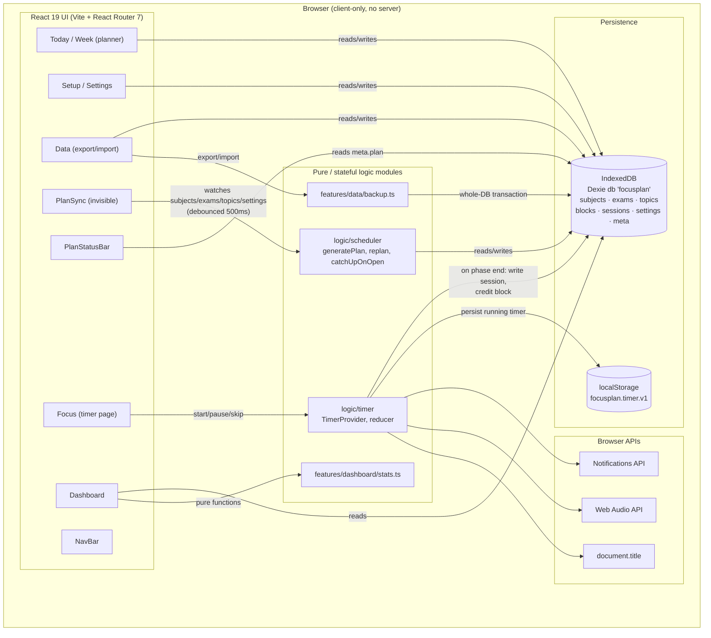
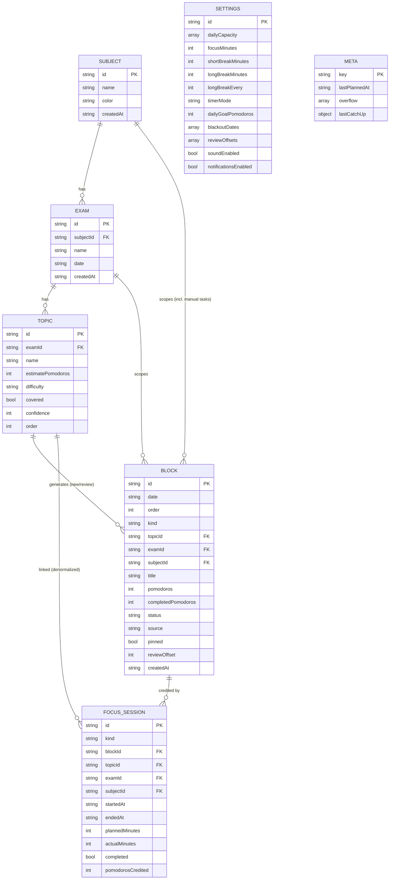

# FocusPlan Architecture

## 1. System overview

FocusPlan is a **client-only single-page application**. There is no backend, no HTTP API and no accounts: every feature — planning, timing, persistence and stats — runs in the browser. Data lives in IndexedDB (via Dexie 4) and every screen reads it reactively with `dexie-react-hooks`' `useLiveQuery`, so a write from any part of the app (a manual edit, the scheduler, or the timer) is reflected everywhere else immediately, with no shared state store and no prop drilling between features.

There is no server round-trip anywhere in this diagram: QA confirmed zero requests to any origin other than the app's own origin across a full session (every route, plus running the timer).

## 2. Components

| Component | Location | Responsibility |
|---|---|---|
| **App shell** | `src/app/` (`App.tsx`, `Layout.tsx`, `NavBar.tsx`, `routes.tsx`, `bootstrap.ts`, `theme.ts`) | Bootstraps the database (seeds if empty) before the first render, wires up `ToastProvider → TimerProvider → BrowserRouter → routes`, renders the nav, a skip link, `PlanSync`/`PlanStatusBar`, an error boundary and route-level code splitting. Toggles dark mode from `prefers-color-scheme`. |
| **Types** | `src/types/index.ts` | The single source of truth for every entity shape (`Subject`, `Exam`, `Topic`, `Block`, `FocusSession`, `Settings`, `OverflowItem`, `PlanMeta`). |
| **Data layer** | `src/db/` (`db.ts`, `settings.ts`, `repo.ts`, `seed.ts`) | The Dexie database, settings get/save, cascade deletes, and the deterministic demo seed. |
| **Shared libs** | `src/lib/` (`dates.ts`, `ids.ts`, `format.ts`) | Date arithmetic (`todayISO`, `addDaysISO`, `weekdayOf`, `startOfWeekISO`), id generation (`newId`, `autoBlockId`) and text/number formatting. |
| **UI primitives** | `src/components/ui/` | Design-system components: Button, Card, Badge, Modal/ConfirmDialog, Field + form controls, EmptyState, Toast, Skeleton/PageError, Icon. |
| **Scheduler engine** | `src/logic/scheduler/` | The pure plan generator (`engine.ts`) and the Dexie-backed service (`planService.ts`) that turns generated plans into database writes. See [§4](#4-the-scheduler-algorithm). |
| **Plan status UI** | `src/features/plan-status/` | `PlanSync` (invisible: runs catch-up on mount, debounced auto-replan on data changes) and `PlanStatusBar` (status row, catch-up notice, over-capacity banner). |
| **Timer engine** | `src/logic/timer/` | A pure, timestamp-driven reducer (`engine.ts`), a `TimerProvider` mounted once at the app root so the timer survives route changes, browser API wrappers (`browser.ts`) and session/block crediting (`credit.ts`). See [§5](#5-the-timer-design). |
| **Focus page** | `src/features/focus/` | The Pomodoro UI: countdown, controls, active-block card, mode switch. |
| **Setup / Settings** | `src/features/setup/`, `src/features/settings/` | Subject/exam/topic CRUD (with quick-add) and the availability/timer settings form. |
| **Planner (Today/Week)** | `src/features/planner/` | The daily queue, the weekly grid, block move/edit/delete, add-task, and Done/Partial/Skip + Topic-check flows. |
| **Dashboard** | `src/features/dashboard/` | Pure stats functions (`stats.ts`) plus the exam cards, focus-minute tiles, 7-day chart (Recharts) and streak. |
| **Data** | `src/features/data/` | Export/import (`backup.ts`), reset-to-demo and clear-all. |

## 3. Data model

Dexie database `focusplan`, version 1. Dates are local calendar dates as `YYYY-MM-DD` strings (`ISODate`); timestamps are ISO 8601 strings (`ISODateTime`). Ids come from `crypto.randomUUID()` (`newId()`) except for deterministic auto-block ids.

Table indexes: `subjects (id, name)` · `exams (id, subjectId, date)` · `topics (id, examId)` · `blocks (id, date, examId, topicId, status)` · `sessions (id, startedAt, blockId, subjectId)` · `settings (id)` · `meta (key)`.

Notes on the model:
- **`Block.kind`** is `'new'` (first-pass study), `'review'` (spaced review) or `'task'` (manual, ad-hoc, never auto-scheduled).
- **`Block.status`** is `'planned' | 'partial' | 'done' | 'skipped'`.
- **`Block.source`** is `'auto'` (written by the scheduler) or `'manual'` (added by the user via the Add-task form).
- **`Block.pinned`** becomes `true` the first time a user moves or edits an auto block; a pinned block is then always kept as-is by future replans.
- **Auto blocks use a deterministic id**, `auto:<topicId>:<kind>:<n>`, so a replan can recognize and update "the same" block rather than deleting and recreating it (and so a running timer's link is never silently orphaned).
- **`FocusSession`** rows are written for both focus *and* break phases (kind `focus` | `shortBreak` | `longBreak`), but only `focus` rows carry Pomodoro credit and count toward stats. A session's `blockId`/`topicId`/`examId`/`subjectId` are captured at the moment the timer starts, so history survives even if the linked block is later deleted by a replan.
- **`meta`** is a two-row table keyed by `key`: `'plan'` (the last plan run's timestamp, overflow list, and last catch-up record) and `'seed'` (whether/when the demo data was seeded, to prevent re-seeding on reload).

### Demo seed

`src/db/seed.ts` seeds — relative to "today" at first load — 3 subjects (Mathematics, Physics, Chemistry), 3 exams (in 7/10/14 days), 12 topics, a short history of completed blocks, two intentionally **missed** blocks (dated yesterday, to demonstrate catch-up), one manual task, and 20 completed focus sessions across the last 5 days (producing a streak of 5 against the default daily goal of 4). `seedIfEmpty()` seeds only once; `resetToDemo()` wipes and reseeds; `clearAll()` wipes and leaves the app empty on reload.

## 4. The scheduler algorithm

The scheduler is deliberately **pure and deterministic** (`src/logic/scheduler/engine.ts`): `generatePlan(input: PlanInput): PlanResult` takes today's date, all subjects/exams/topics/settings and the existing blocks, and returns which blocks to keep, which to create, which ids to remove, and what could not be scheduled. It performs no I/O, which is what makes it heavily unit-testable (57 scheduler/service tests, per `.pipeline/handoffs/phase-P1.md`).

**Rules, in order:**

1. **What's kept.** Blocks that are `done`, `partial`, `skipped`, `pinned`, `manual`, or `planned` with `completedPomodoros > 0` are always kept unchanged (protecting in-progress and user-arranged work). Everything else that is a still-`planned`, unpinned auto block is a candidate for removal and regeneration.
2. **Remaining new work per topic** = `estimatePomodoros − completed − still-planned-kept`, and is 0 once a topic is marked Covered.
3. **New-study blocks** are chunked to at most 2 Pomodoros each, and must land on or before `examDate − 2` days.
4. **Review blocks** are 1 Pomodoro each, placed at each offset in `settings.reviewOffsets` (default `[1, 3, 7]`) after the topic's last new block, and must land on or before `examDate − 1`. Offsets that don't fit are dropped, not counted as failure. A topic marked Covered at **confidence 1** gets exactly one extra review, at an offset one day after the first configured offset (skipping any offset already in use).
5. **Placement.** Each exam's new work is paced roughly evenly from today toward its deadline (with slack reserved for reviews); if that overflows, a greedy earliest-deadline-first fill is tried instead, and whichever produces less overflow is used. Days are filled up to that weekday's remaining capacity (`settings.dailyCapacity[weekday] − pomodoros already kept that day`); blackout dates get nothing.
6. **Interleaving.** If a day would otherwise hold work from only one subject while two or more exams still have pending work, the scheduler pulls in a block from another subject (a new block, or a review due within 2 days) so the day isn't single-subject.
7. **Overflow.** Anything that can't be placed is reported with a reason: `exam-passed` (the exam is today or has already passed) or `no-capacity` (everything else, including the reviews attached to new work that itself didn't fit).

**Catch-up and replan** (`planService.ts`):
- `replan(opts?)` runs `generatePlan` inside one Dexie transaction, applies the create/keep/remove diff, and records `meta.plan` (timestamp + overflow).
- `catchUpOnOpen()` additionally removes any `planned` unpinned auto blocks still dated in the past (moving that work forward via the same regeneration) and records `meta.plan.lastCatchUp` (`{movedCount, at}`), which drives the "Moved N missed blocks" notice.
- `PlanSync` (a mounted-but-invisible component) calls `catchUpOnOpen()` once on load, then live-queries subjects/exams/topics/settings (deliberately **not** `blocks`, to avoid a feedback loop) and calls `replan()` 500ms after the last change — this is why routine edits in Setup/Settings never require a manual "Replan" click.
- Running `replan()` twice with no input changes is idempotent: identical block ids and dates both times, verified by unit and e2e tests.

## 5. The timer design

The Pomodoro timer (`src/logic/timer/`) is a **pure reducer driven by wall-clock timestamps**, not by counting ticks — the standard fix for the fact that browsers throttle `setInterval`/`setTimeout` in background tabs.

- State tracks `endsAt` (an absolute timestamp) rather than "seconds remaining." Remaining time for a countdown phase is always computed as `endsAt − Date.now()` on every tick (every 250ms) and again on `visibilitychange`/`focus`, so a throttled or backgrounded tab self-corrects the instant it's foregrounded, with no drift.
- The full state is mirrored to `localStorage['focusplan.timer.v1']` on every change and restored on load; if a phase actually finished while the tab was closed, it is completed and credited silently on restore.
- **Phases:** `focus → shortBreak`, with a `longBreak` after every `settings.longBreakEvery` completed focus sessions (default 4). Phase lengths come from `settings.focusMinutes` / `shortBreakMinutes` / `longBreakMinutes`. A finished phase always drops back to `idle` — the timer never auto-starts the next phase, by design, so the student stays in control.
- **Flowtime mode** inverts the focus phase: it counts *up* with no fixed end. `endFlow()` computes a break of `max(1, round(focusMinutes / 5))` minutes and credits `floor(elapsedMinutes / focusMinutes)` Pomodoros (minimum 1 once at least a minute has elapsed).
- **Crediting** (`credit.ts`): when a focus phase ends, one `sessions` row is written (`kind:'focus'`, deterministic id `timer:<phase>:<phaseStartedAtMs>` so nothing is double-counted across StrictMode or a restore); if a block is linked, its `completedPomodoros` increments and its `status` becomes `partial` or `done` once full. If the linked block was deleted by a replan in the meantime, the session is still saved using the topic/exam/subject captured at start — no data is lost, but nothing is credited to a block that no longer exists.
- **Break sessions are also recorded** (`kind: 'shortBreak' | 'longBreak'`, no credit), which the Dashboard's stats functions filter out by `kind === 'focus'`.
- **Side effects**, all best-effort and guarded by try/catch so a denied permission never breaks the timer: a browser Notification at each phase end (permission requested on first Start), a Web Audio chime, and a `document.title` that mirrors the countdown (`MM:SS · <Phase> — FocusPlan`, or `FocusPlan` when idle).
- `TimerProvider` is mounted once, near the root of the component tree (inside `ToastProvider`, outside `BrowserRouter`), so the timer keeps running across route changes — for example, you can navigate to Setup while a focus session is active and a small pill in the nav bar keeps showing the countdown and links back to `/focus`.

## 6. Contracts between modules

Because there is no HTTP API, the "contract" between build phases and between features is a small set of frozen TypeScript module signatures, established up front and never changed (only added to). This is the same information as `docs/api-reference.md`, summarized here as an architectural decision:

| Module | Exports | Consumed by |
|---|---|---|
| `@/types` | Every entity type | Everything |
| `@/db` | `db`, `getSettings`/`saveSettings`, `deleteExamCascade`/`deleteSubjectCascade`, `seedIfEmpty`/`resetToDemo`/`clearAll` | Every feature |
| `@/logic/scheduler` | `generatePlan(input): PlanResult` (pure) | `planService`, unit tests |
| `@/logic/scheduler/planService` | `replan(opts?)`, `catchUpOnOpen()`, `trimLargestReview(opts?)` | `PlanSync`, `PlanStatusBar` |
| `@/logic/timer` | `TimerProvider`, `useTimer()` | `FocusPage`, `NavBar` (timer pill), any page that needs timer status |
| `@/features/dashboard/stats` | Pure functions: `readiness`, `streak`, `focusMinutesToday/ThisWeek`, `last7DaysSeries`, etc. | `DashboardPage` |
| `@/features/data/backup` | `parseBackup`, `buildBackup`, `replaceAllData`, `downloadBackup` | `DataPage` |

## 7. Key design decisions and why

| Decision | Reason |
|---|---|
| **No backend, IndexedDB via Dexie** | The product's fifth USP is "local-first, no account." A server would add auth, hosting and privacy surface for no benefit to a single-user planning tool, and it directly avoids the paywall/sync complaints found against competitors in the research (My Study Life's caps, Focus To-Do's buggy paid sync). |
| **`useLiveQuery` instead of a global store (Redux/Zustand)** | Every screen reads Dexie directly and reactively. Five build phases (scheduler, timer, setup, planner, dashboard) could be built in parallel against the shared database with no risk of one phase's in-memory state going stale relative to another's writes. |
| **Timestamp-based timer, not tick-counting** | Browsers throttle timers in background tabs; computing remaining time from `endsAt − now()` on each tick and on `visibilitychange` is the standard, drift-free approach, and it's what lets the timer survive a page reload correctly. |
| **Deterministic auto-block ids (`auto:<topicId>:<kind>:<n>`)** | Lets a replan recognize "the same" auto-generated block across runs (for idempotency) and protects a block the timer is actively crediting from being silently deleted mid-session. |
| **Pure `generatePlan()` with no I/O** | Keeps the hardest logic in the app (exam-backward spacing, capacity, interleaving, overflow) unit-testable without a browser or a database — 57 scheduler/service tests run in Vitest with `fake-indexeddb`. |
| **PlanSync watches inputs, not `blocks`** | Prevents an infinite replan loop (the scheduler writing blocks would otherwise re-trigger itself) and keeps a 500ms debounce so bulk edits (e.g. quick-add) don't cause a replan storm. |
| **Sessions capture topic/exam/subject at start, not just a block reference** | If a replan removes the linked block mid-focus, focus history and stats remain accurate rather than silently losing the session. |
| **Vite SPA over a full-stack framework (e.g. Next.js)** | There is no server rendering, no API routes and no auth to justify one; a Vite SPA builds faster and is simpler to test end-to-end with Playwright. |
